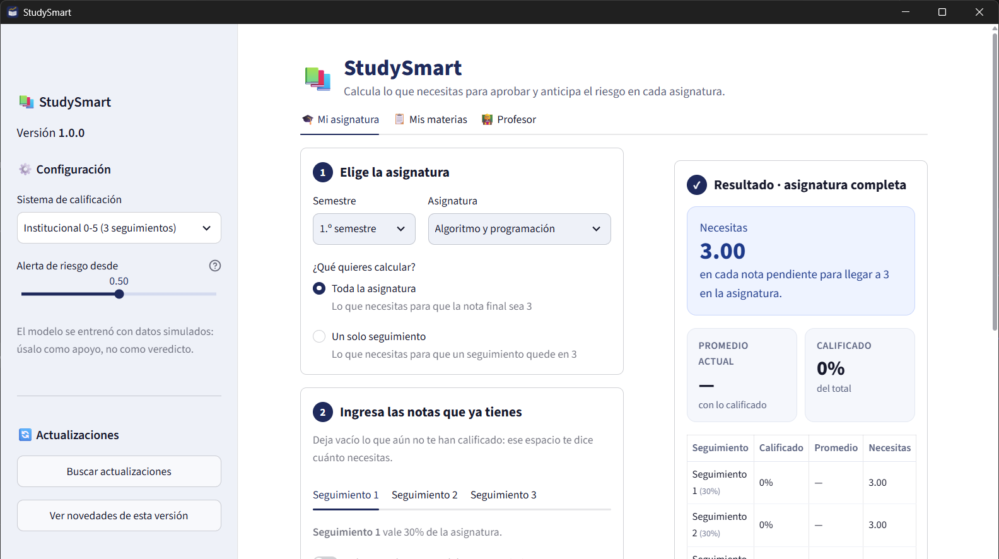

<div align="center">


# StudySmart

**Calcula lo que necesitas para aprobar y anticipa el riesgo de perder cada asignatura.**

[](https://github.com/OpTicXit/StudySmart/releases/latest)
[](https://github.com/OpTicXit/StudySmart/releases)

[](LICENSE)

### [⬇️ Descargar StudySmart para Windows](https://github.com/OpTicXit/StudySmart/releases/latest)



</div>

---

## ¿Qué hace?

StudySmart es un programa de escritorio para estudiantes y docentes. Con las notas que ya tienes te dice:

- 🎯 **Cuánto necesitas** en cada nota pendiente para aprobar la asignatura o un seguimiento.
- 📈 **Tu riesgo de perder la materia** y la nota final prevista, desde la primera nota.
- 🧭 **Tu perfil de estudio** y recomendaciones concretas (por ejemplo, practicar ejercicios en lugar de solo estudiar más horas).
- 📋 **Qué materia priorizar**, ordenando todas tus asignaturas de mayor a menor riesgo.
- 👩‍🏫 **Panel docente**: sube un CSV del curso y obtén a los estudiantes ordenados por riesgo, con el detalle de cada uno.

Funciona con cualquier sistema de calificación: 0–5, 0–10, 0–20, 0–100 o letras, con los seguimientos y pesos que defina tu institución.

## Instalación

1. Descarga **`StudySmart-Setup-x.y.z.exe`** desde la [última versión](https://github.com/OpTicXit/StudySmart/releases/latest).
2. Ábrelo y sigue el asistente. No necesitas permisos de administrador ni instalar Python.
3. Abre **StudySmart** desde el menú Inicio o el acceso directo del escritorio.

> **¿Windows muestra "Windows protegió su PC"?** Aparece con los programas nuevos que aún no tienen firma digital.
> Haz clic en **Más información → Ejecutar de todas formas**.

**Requisitos:** Windows 10 u 11 de 64 bits y unos 600 MB libres. La conexión a internet solo se usa para buscar actualizaciones.

## Actualizaciones

StudySmart revisa al abrirse si hay una versión nueva. También puedes hacerlo desde la barra lateral con **🔄 Buscar actualizaciones**:

1. Si hay una versión nueva, verás sus **novedades y correcciones**.
2. Pulsa **Actualizar ahora**: se descarga, se instala y StudySmart vuelve a abrirse solo.
3. Al abrir la versión nueva, te muestra otra vez qué cambió.

Tus registros guardados están en `%APPDATA%\StudySmart` y se conservan entre actualizaciones. El historial completo de cambios está en [CHANGELOG.md](CHANGELOG.md).

## Cómo se usa

| Pestaña | Para qué sirve |
|---|---|
| 🎓 **Mi asignatura** | Elige la materia, escribe las notas que ya tienes y, si quieres, tus hábitos de estudio. A la derecha ves cuánto necesitas, tu riesgo y las recomendaciones. |
| 📋 **Mis materias** | Compara las materias que agregaste y te dice cuál atender primero. |
| 👩‍🏫 **Profesor** | Descarga la plantilla, llénala con tu curso y súbela para ver a los estudiantes en riesgo. |

En la barra lateral eliges el **sistema de calificación** y desde qué probabilidad se considera **riesgo alto**.

## ¿Cómo funciona?

StudySmart nació como proyecto de **Minería de Datos** y sigue la ruta dato → información → patrón → decisión:

- **Datos:** registros por estudiante, asignatura y semestre (notas parciales, asistencia, actividades, ejercicios, comprensión).
- **Información:** indicadores como el promedio y la tendencia de los cortes.
- **Patrones:** perfiles de estudio con **K-Means** y predicción del riesgo con **Random Forest** (PR-AUC 0,675 y *recall* 0,81 en estudiantes no vistos).
- **Decisión:** priorizar asignaturas y recomendar cómo estudiar.

> ⚠️ El modelo se entrenó con **datos simulados** porque aún no hay registros reales suficientes. Úsalo como apoyo, no como veredicto.
> El análisis completo está en [`reports/informe.md`](reports/informe.md) y en los cuadernos de [`notebooks/`](notebooks).

## Para desarrolladores

<details>
<summary>Ejecutar desde el código fuente</summary>

```powershell
python -m venv .venv
.venv\Scripts\activate
pip install -r requirements.txt
python lanzador.py              # en su ventana  (o: streamlit run app.py)
```

Para volver a entrenar el modelo, ejecuta en orden los cuadernos `notebooks/01` a `04`.
</details>

<details>
<summary>Construir el instalador</summary>

Necesitas [Inno Setup 6](https://jrsoftware.org/isinfo.php) (`winget install JRSoftware.InnoSetup`).

```powershell
pip install -r requirements-app.txt
.\build.ps1                     # crea dist\StudySmart-Setup-<versión>.exe
```
</details>

<details>
<summary>Publicar una versión nueva (solo el autor)</summary>

1. Escribe las novedades en [CHANGELOG.md](CHANGELOG.md) bajo `## [1.1.0] - AAAA-MM-DD`, con los apartados **Novedades** y **Correcciones**.
2. Ejecuta `.\publicar.ps1 1.1.0`.

GitHub Actions construye el instalador y publica la versión con esas notas. Los usuarios la reciben con el botón de actualizar.
</details>

| Carpeta | Contenido |
|---|---|
| `app.py` | Interfaz (Streamlit) |
| `lanzador.py` | Punto de entrada del `.exe`: abre la ventana y el servidor |
| `src/` | Calificación, modelo, recomendaciones, versión y actualizador |
| `models/` | Modelo entrenado |
| `notebooks/`, `reports/` | Análisis de minería de datos e informe |
| `installer/`, `build.ps1`, `publicar.ps1` | Instalador y publicación |

## Licencia

**© 2026 Miguel Ángel Martínez. Todos los derechos reservados.**

Puedes descargar, instalar y usar StudySmart **gratis** para fines personales, educativos o académicos.
No está permitido modificarlo, redistribuirlo, venderlo ni presentarlo como propio sin permiso escrito del autor.
Lee las condiciones completas en [LICENSE](LICENSE).

**Componentes de terceros:** Python, Streamlit, scikit-learn, pandas, NumPy y pywebview, cada uno con su licencia.
Datos de contraste: *Student Performance* (Cortez, 2008) y *Predict Students' Dropout and Academic Success* (Realinho et al., 2021), del [UCI Machine Learning Repository](https://archive.ics.uci.edu), con licencia CC BY 4.0.
